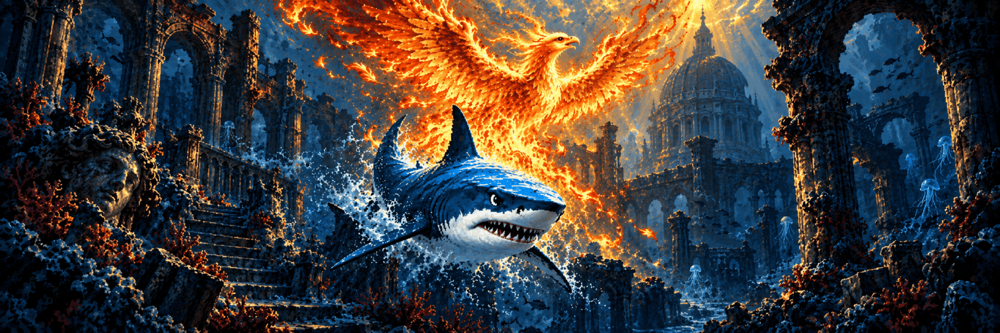

## What's new in MAKO Renderer v5.0.0

### Release codename: Phoenix

> _“In the deepest dark, the phoenix kindled a tide the abyss had never known.”_
>
> **Tavian Rook, _Annals of the Ember Tide_**

---

Phoenix introduces MAKO FG, an open-weight Frame Generation model for games on SteamOS and Linux. Bundled with MAKO Renderer, it generates the frames between two consecutive real game frames on the GPU. At 3× output, two generated frames share the motion work for each pair of real frames, turning 30 FPS into 90 FPS or 40 FPS into 120 FPS when the game and GPU sustain that rate. It also supports 2×, 4× and other requested output schedules. Free for non-commercial use, with no Lossless Scaling required. See the [model card](https://github.com/eugeniosegala/MAKO/blob/main/engine/docs/mako-fg/MODEL_CARD.md) for its design, training data, benchmarks and limitations. Download the model and runtime from [Hugging Face](https://huggingface.co/eugeniosegala/MAKO-FG).

- **MAKO FG:** V1.22 ships in Renderer packages for 64-bit and 32-bit x86 games and Flatpak runtimes. It runs as a separate program, so if it fails the game keeps its real frames while MAKO FG restarts automatically, and it also runs for self-contained AppImages that bring their own graphics driver. It supports Fixed and Adaptive Frame Generation, SDR, HDR and Flow Scale, and is the default for profiles without a saved model, including every profile from an earlier release. Developed by Eugenio Segala; its weights use a non-commercial license. See the [setup guide](https://github.com/eugeniosegala/MAKO/blob/main/engine/docs/MAKO-FG.md).
- **Choose your model:** Pick **MAKO FG**, **LSFG Quality** or **LSFG Performance** per profile and power mode. Switching between MAKO FG and LSFG needs a game restart; LSFG Quality and Performance switch live. LSFG models and LS1 scaling still need your own Lossless Scaling installation. If LSFG cannot start, the Renderer falls back to MAKO FG without changing the saved choice. A missing Lossless Scaling file, such as on an unmounted SD card, also keeps the saved choice; the app switches to MAKO only when the file is present and fails its check.
- **Tune MAKO FG:** Flow Scale trades motion detail for GPU work. Ultra Performance now works with MAKO FG, using 60% Flow Scale and, with Scaling on, MAKO Scaler. MAKO FG accepts frames up to 8,294,400 pixels (the area of 3840×2160) and 8192 pixels per side; its analysis grid may be capped at higher resolutions.
- **MAKO FG Mode:** At 2× and 3×, Quality, Balanced, Performance and Extra Performance solve motion on every real-frame pair down to one in four, and apply live. Balanced is the default. Reusing motion saves GPU time and can add artifacts in fast changes of direction. At 4× and above, every pair solves regardless of the selected mode; Ultra Performance uses at least Performance.
- **MAKO Scaler by default:** Profiles without a saved scaling method use MAKO Scaler; saved choices stay. Eligible scaling paths write directly to presentation images, and HDR-capable bridge paths resize without a game-side resize.
- **Record frames for comparison:** Opt-in burst and rolling capture save real game frames locally for offline model comparisons. Rolling capture keeps recent frames in memory until saved; burst capture pauses Frame Generation. With recording armed, MAKO Decky handles the L3 + R3 shortcut. See [recording setup and limits](https://github.com/eugeniosegala/MAKO/blob/main/engine/docs/MAKO-FG.md#record-test-frames).
- **Mailbox Presentation:** A restart-required compatibility option, off by default, for games that hang or fail under FIFO presentation. It uses MAILBOX where supported, so newer frames can replace pending ones, which may reduce smoothness.
- **MangoHud real FPS:** With MangoHud enabled, **Count Real Frames Only** shows the game's real frame rate instead of including generated frames. It needs a restart and keeps the existing host MangoHud restrictions.
- **Adaptive and bridge pacing:** Recovery skips probes that cannot succeed, and the Gamescope bridge drains queued refreshes after sustained timing drift. When a game's own clock runs faster than the display can show at the chosen multiplier, such as a 62.5 Hz engine tick at 2× and 120 Hz, Adaptive restores its normal pacing within a few seconds instead of letting the game overfill the display queue and stutter.
- **OpenGL games through Zink:** With Frame Generation, an OpenGL game running through Zink faster than the display could close when its swapchain was destroyed, or run ahead of MAKO's pacing. MAKO now holds Zink to the swapchain images it requested, so these games follow MAKO's pacing like Vulkan games.
- **Even pacing on the desktop:** Outside Gamescope, such as on the KDE Plasma desktop, Frame Generation now spreads generated frames evenly between real frames when their combined rate is below the display's refresh rate, instead of showing them back to back and then holding the last one. Low-frame-rate video and capped games benefit most. Each real frame can reach the screen up to one source interval later, and spacing switches off for a game it would slow down. Game Mode is unchanged.
- **Games Steam starts with its older Vulkan loader:** Frame Generation now works when Steam's shader pre-caching layer loads above MAKO, as it can for non-Steam games such as AppImages, and games that create X11 windows no longer crash on that loader.
- **MAKO FG in games with large per-thread data:** MAKO FG now starts in games that keep a lot of thread-local data, such as some native ports, which previously kept their own frames.
