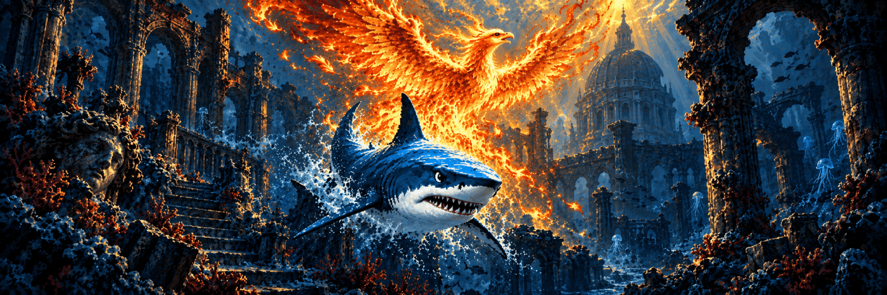

## What's new in MAKO Decky v5.0.0

### Release codename: Phoenix

> _“Where the phoenix lit the drowned stones, the mako found a way through.”_
>
> **Mira Valen, _Charts of the Ember Tide_**

---

Phoenix brings bundled MAKO FG to MAKO Decky through the matching Renderer: open-weight Frame Generation for SteamOS and Linux. At 3×, shared motion work can turn 30 FPS into 90 FPS when the game and GPU sustain it; 2×, 4× and other output schedules are also supported. Free for non-commercial use, with no Lossless Scaling required. See the [model card](https://github.com/eugeniosegala/MAKO/blob/main/engine/docs/mako-fg/MODEL_CARD.md) for design, benchmarks and limitations, or download the model and runtime from [Hugging Face](https://huggingface.co/eugeniosegala/MAKO-FG).

- **MAKO FG:** V1.24 supports Fixed and Adaptive Frame Generation, SDR, HDR and Flow Scale, including self-contained AppImages. It is the default for profiles without a saved model, including profiles from earlier releases. Developed by Eugenio Segala. See the [setup guide](https://github.com/eugeniosegala/MAKO/blob/main/engine/docs/MAKO-FG.md).
- **Pick a Frame Generation model:** Choose **MAKO FG**, **LSFG Quality** or **LSFG Performance** per profile and power mode. Switching between MAKO FG and LSFG needs a restart; LSFG Quality and Performance switch live. LSFG and LS1 still require your own Lossless Scaling installation.
- **Clearer model availability:** Unavailable Lossless Scaling choices are grayed out; MAKO FG and MAKO Scaler stay usable. Failed LSFG starts fall back to MAKO FG without changing the saved choice. A missing DLL keeps that choice with a warning; the editor changes it only when a present DLL fails validation. Live Status shows the running model.
- **MAKO FG performance controls:** Flow Scale trades motion detail for GPU cost. Ultra Performance uses 60% Flow Scale and MAKO Scaler when Scaling is on. Supports frames up to 8,294,400 pixels (the area of 3840×2160) and 8192 pixels per side; the analysis grid may be capped at higher resolutions.
- **MAKO FG Mode:** Quality, Balanced, Performance and Extra Performance switch live and control how often motion is fully estimated at 2× and 3×. Balanced and Performance correct motion between full estimates; Extra Performance uses cheaper reuse when frames arrive evenly and correction otherwise. Start with Balanced; try Quality for artifacts in fast motion. At 4× and above, every pair gets a full estimate. Ultra Performance uses at least Performance.
- **MAKO Scaler by default:** Profiles without a saved scaling method use MAKO Scaler; existing choices stay. The Renderer improves eligible scaling and HDR bridge paths.
- **Capture frames for comparison:** Arm burst or rolling capture, then press L3 + R3 to save real frames locally. Rolling mode buffers recent frames until saved; burst pauses Frame Generation. The game also receives the button press. See [recording setup and limits](https://github.com/eugeniosegala/MAKO/blob/main/engine/docs/MAKO-FG.md#record-test-frames).
- **Mailbox Presentation:** Optional compatibility setting for FIFO hangs or failures, off by default. Requires a restart. Where supported, newer frames replace queued ones, which may reduce smoothness.
- **MangoHud real FPS:** **Count Real Frames Only** excludes generated frames from MangoHud's FPS counter. Requires a restart and host-installed MangoHud; cannot run alongside MAKO Shaders.
- **Adaptive and bridge pacing:** Skips recovery probes that cannot succeed, handles Gamescope timing drift, and restores normal Adaptive pacing within seconds when a game's clock outpaces the display at the chosen multiplier.
- **OpenGL games through Zink:** Fixes swapchain failures and uneven pacing after loading screens. With Base FPS Cap off and a known Gamescope refresh, Fixed mode paces eligible Zink games at refresh divided by the multiplier; Dynamic Cadence Recovery keeps that cap off. Workarounds also address colour speckles and tearing. See [compatibility settings and limits](https://github.com/eugeniosegala/MAKO/blob/main/plugin/docs/CONFIGURATION.md#compatibility-and-external-tools).
- **Even pacing on the desktop:** Outside Gamescope, generated frames are spaced evenly when total output is below display refresh, helping capped games and low-FPS video at some added latency. Game Mode is unchanged.
- **Non-Steam games and AppImages:** Fixes Frame Generation under Steam's older Vulkan loader and shader pre-caching layer, plus related X11 window crashes.
- **Proton 8 and 9 offscreen windows:** Applies Wine's workaround on the first enabled launch, fixing offscreen Frame Generation in games such as Half-Life 2. If video or UI displays incorrectly, add `WINE_DISABLE_VK_CHILD_WINDOW_RENDERING_HACK=0` before `mako-run`. Other Proton versions may use different paths; see [setup and limits](https://github.com/eugeniosegala/MAKO/blob/main/plugin/docs/CONFIGURATION.md#proton-offscreen-windows).
- **MAKO FG in games with large per-thread data:** Fixes MAKO FG startup in games with large thread-local allocations, including some native ports.
